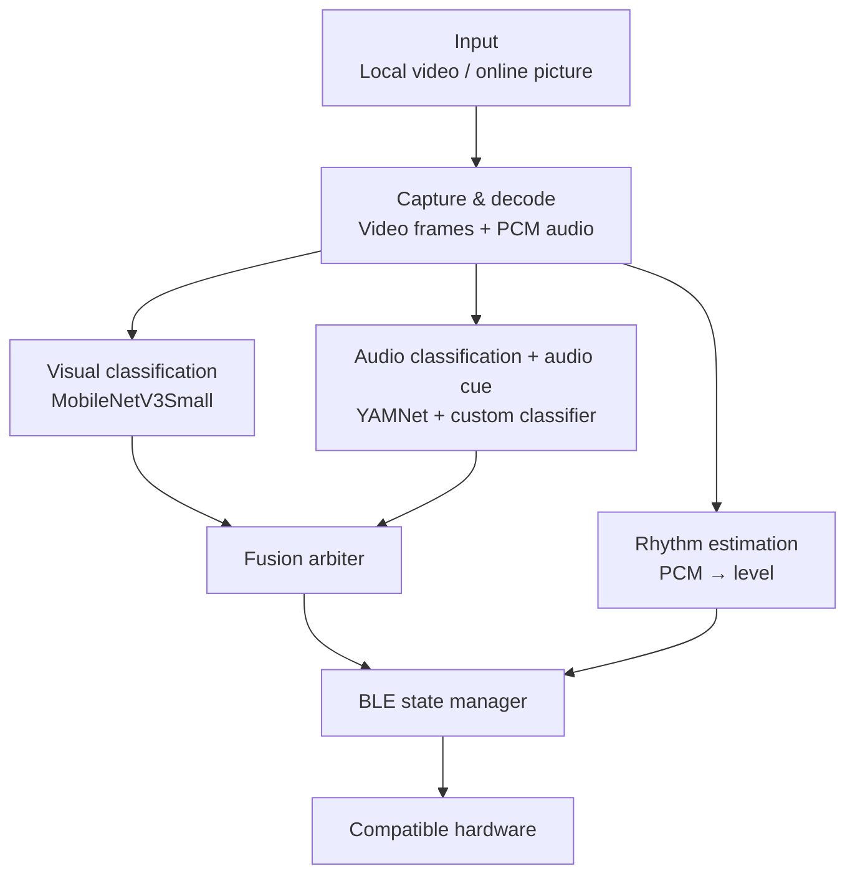

# Xcup iOS

[中文](README.md) | **English**

Real-time video understanding with BLE device control, running on iOS.

Xcup iOS takes the picture and audio from a local video or from live/online playback, classifies the action and estimates its rhythm intensity on the device, then passes the results through a fusion arbiter and a state manager before sending control commands to compatible BLE hardware.

This project is a port of [Xcup Android](https://github.com/Tingfu-Zhou/xcup-android). It keeps the Android app's on-device inference, multimodal fusion, playback sync and BLE control logic, reimplemented with Apple platform technologies such as AVFoundation, ReplayKit, CoreBluetooth, Swift and GCD.

> This project deals with recognizing adult content and is intended for adults only. Use it in compliance with local laws, content licensing, privacy requirements and the rules of any third-party platforms involved.

## Features

- Local video analysis: load a video from Photos or the file picker; the picture and audio are analyzed in sync with playback.
- Online/live analysis: records the screen through a ReplayKit broadcast upload extension (`XcupBroadcast`) and takes the screen image plus audio played by other apps. Black bars around the video are removed from screenshots, and analysis pauses during silence.
- On-device visual inference: a MobileNetV3Small TFLite model classifies frames as plot, oral or sex. Each frame is preprocessed the same way as the training data (center square crop → 224 → 160).
- On-device audio inference: YAMNet plus a custom classifier detects the action. The same inference pass also reads YAMNet's built-in 521 AudioSet scores to judge how reliable the audio is at that moment (audio cues: dialog, music, quiet, unclear, vocal, impact, etc.).
- Rhythm intensity estimation: turns PCM audio into discrete intensity levels that are sent to the hardware along with the action state.
- Multimodal fusion (fusion arbiter v2): starting, holding and stopping the motor are decided separately, and evidence is counted per new inference result. Starting needs agreement from both modalities or sustained audio evidence; holding needs support from either one. Audio cues are also used when starting: when the audio is masked by background music and stays unclear, video may start the motor on its own; when video is confident the scene is plot, audio false positives caused by dialog don't count as start evidence.
- BLE control: automatic scanning, connection, protocol frame building, CRC checks, status parsing and command sending with CoreBluetooth.
- Manual Controls: pick a vibration pattern (1-3) and motor intensity (0-10) directly in the app instead of cycling through the device's physical button. Available only after connecting to the device on the home screen; until then the entry is grayed out and tapping it just shows a hint.
- Timed intensity boost (turned on in Manual Controls, off by default): once video analysis has been playing for the set time (1-30 minutes), the level sent to the device is raised by +1 or +2 to simulate approaching climax. Level 0 still means stop, and the maximum is 10. Paused and silent periods don't count, and the timer resets when you leave the mode or the video ends.
- Device button takes priority: the hardware button can pause app control, and a hint appears at the bottom of the screen. Users restore control with Resume App Control in Manual Controls (the resume button on the home screen is hidden).
- Playback sync: play, pause, seek, resume after the end and rotation. After a seek, history is reset and the analysis pipeline resyncs.
- Update check: reads a remote version config to offer an optional or required update and links to the App Store.
- Localized UI: Chinese, Japanese and English, chosen automatically from the system language; users can also pick the app's language in Settings → Xcup → Language.

## Relationship to the Android App

| Capability | Android | iOS |
| --- | --- | --- |
| Local video analysis | Yes | Yes |
| Online/live analysis | MediaProjection + AudioPlaybackCapture | ReplayKit broadcast upload extension |
| Web video mode | Removed | Not supported |
| Manual Controls, timed boost | Yes | Yes |
| On-device visual inference | LiteRT (TensorFlow Lite) | TensorFlow Lite (`TensorFlowLiteSwift`) |
| On-device audio inference | YAMNet + custom classifier | YAMNet + custom classifier |
| BLE | Android BLE API | CoreBluetooth |
| Player | VideoView | AVPlayer |
| Benchmark CSV (`BenchLogger`) | On in debug builds | None |

The Android app is the upstream reference. Both apps use the same model files and aim to keep model input, fusion logic, action mapping and BLE behavior consistent; modules ported line by line are checked against the same golden data generated on Android (see "Run tests"). Because of differences in platform APIs and media architecture, the rest is not a line-by-line match.

## How It Works



The system runs three pipelines in parallel:

1. Video: grab frames by playback time, keep a 12-frame window and run MobileNetV3Small periodically.
2. Audio: convert audio to 16 kHz PCM, read the latest ~2 seconds (32,000 samples) from the ring buffer, run YAMNet, use the AudioSet scores from the same pass to derive the audio cue (`AudioCue`), and estimate rhythm intensity.
3. Fusion: every 500 ms, read the latest results (audio results carry a cue), drop stale data, let `FusionArbiter` decide the action for this tick (start, hold and stop judged separately), and pass it with the loudness level to the BLE state manager.

Video and audio inference run on separate background queues; the main thread coordinates UI updates, consuming fusion results and user interaction. Shared results are protected with thread-safe containers and `DispatchQueue` barriers so the PCM buffer and analysis state aren't read and written concurrently.

## Android-to-iOS Mapping

| Android | iOS |
| --- | --- |
| `VideoProcessActivity.java` | `VideoProcessViewController.swift` |
| `OnlineAnalysisActivity.java` | `OnlineAnalysisViewController.swift` |
| `ManualControlActivity.java` | `ManualControlView.swift` |
| VideoView | AVPlayer |
| MediaExtractor + MediaCodec (audio decoding) | AVAssetReader + AVAssetReaderTrackOutput |
| `VideoFrameExtractor.java` + `EGLRenderer.java` (frame extraction) | `VideoFrameExtractor.swift`: AVPlayerItemVideoOutput + vImage |
| `FramePreprocessor.java` | `FramePreprocessor.swift` (line-by-line port; `XcupTests` checks it bit for bit against Android golden data) |
| `ScreenCropper.java` | `ScreenCropper.swift` (line-by-line port; `XcupTests` checks it frame by frame against Android golden data) |
| `OnlineAnalysisService.java` (MediaProjection screen capture) | `XcupBroadcast` broadcast upload extension (ReplayKit): uprights frames using `RPVideoSampleOrientationKey` and passes them, with orientation, to the main app through an App Group |
| Handler / Runnable | DispatchQueue, DispatchSourceTimer, CADisplayLink |
| `PcmResampler.java` | `PcmResampler.swift` (line-by-line port, checked sample by sample in `XcupTests`; the broadcast extension has a verbatim copy) |
| `PcmCircularBuffer.java` | `PcmCircularBuffer.swift` |
| `FusionArbiter.java` | `FusionArbiter.swift` (line-by-line port; `XcupTests` checks it tick by tick against Android golden data) |
| `AudioCue.java` | `AudioCue.swift` (line-by-line port; `XcupTests` checks group scores and cues bit for bit against Android golden data) |
| `LevelBoost.java` | `LevelBoost.swift` (line-by-line port; `XcupTests/LevelBoostTests` mirrors Android `LevelBoostTest` one to one) |
| `AudioInferenceHelper.java` | `AudioInferenceHelper.swift` |
| `UpdateChecker.java` | `UpdateService.swift` |
| Android BLE API | `BluetoothManager.swift` + CoreBluetooth |
| `synchronized` / atomics | DispatchQueue barriers, synchronous reads and thread-safe result containers |

## Core Components

| Component | Purpose |
| --- | --- |
| `ContentView.swift` | Home screen, video picker, BLE status, online analysis entry and navigation |
| `VideoProcessViewController.swift` | Video playback, audio/video analysis, fusion, UI updates and BLE control |
| `OnlineAnalysisViewController.swift` | Online analysis: reads frames and audio from the broadcast extension, detects silence, reuses the offline inference and fusion logic |
| `XcupBroadcast/BroadcastSampleHandler.swift` | Broadcast upload extension: receives ReplayKit frames and audio, writes frames (with orientation) and audio resampled to 16 kHz into App Group shared files |
| `BroadcastBridge.swift` | Main-app side that reads what the broadcast extension writes |
| `VideoFrameExtractor.swift` | Uses AVPlayerItemVideoOutput to grab the frame the player is showing, crops the center square, scales to 672×672 with vImage and uprights it using preferredTransform before handing it to FramePreprocessor |
| `FramePreprocessor.swift` | Video model input preprocessing (center square crop, area-average downscale to 160×160), matching the training data; shared by offline and online modes |
| `ScreenCropper.swift` | Online mode: finds the video inside the screenshot (removes symmetric black bars) so `FramePreprocessor` takes the center square of the video itself |
| `VideoClassifierHelper.swift` | MobileNetV3Small TFLite inference wrapper |
| `AudioDecoder.swift` | Decodes audio with AVAssetReader, with rate limiting and seeking, and writes it to the PCM buffer |
| `PcmResampler.swift` | Streaming downmix and anti-aliased resampling to 16 kHz, sample-identical to Android |
| `PcmCircularBuffer.swift` | PCM ring buffer, time-window reads and concurrent access |
| `AudioInferenceHelper.swift` | YAMNet feature extraction and custom audio classifier; also returns the 521 AudioSet scores from the same pass |
| `AudioCue.swift` | Audio cue: groups AudioSet scores by meaning and classifies dialog / music / quiet / unclear / vocal / impact / other for the arbiter's start rules |
| `AudioLoudnessLevelEstimator.swift` | Loudness, smoothing, confidence and discrete level estimation |
| `ThreadSafeAnalysisResults` (in `VideoProcessViewController.swift`) | Stores and reads analysis results safely across threads |
| `FusionArbiter.swift` | Fusion arbiter: decides when the motor starts, holds and stops from new results of both modalities (audio results carry a cue); shared by offline and online modes |
| `LevelBoost.swift` | Timed boost: counts only time while analysis is running and, once due, adds 1 or 2 levels to what is sent to the device (the analysis level is unchanged); setting keys and reads live in `LevelBoostSettings` |
| `ManualControlView.swift` | Manual Controls: pattern, intensity slider, Emergency Stop and send throttling; timed boost settings |
| `BluetoothManager.swift` | BLE scanning, connection, protocol frames, CRC checks and state management |
| `UpdateService.swift` | Fetches the `ios` section of `version.json` and decides between optional and required updates |

`InferenceHelper.swift` (ML Kit pose detection + ST-GCN++), `AudioRhythmEstimator.swift`, `VideoRhythmEstimator.swift` and `VideoMotionWaveEstimator.swift` are left over from earlier approaches and are no longer used.

## Models

### Video model

- Architecture: MobileNetV3Small + Temporal Average Pooling + 3-class head (same model file as Android; since 2026-10-18 this is the retrained E1d version)
- File: `mobilenetv3small_tap_3class_float32.tflite`
- Input: `[1, 12, 160, 160, 3]`, `float32`, NHWC, RGB; the 12 frames are 12 distinct moments 250 ms apart from the last 3 seconds
- Pixel range: `0-255`. The model includes a Rescaling layer, so don't normalize again
- Per-frame preprocessing matches the training data: upright the frame, crop the center square (side = short edge), area-average downscale to 224, then to 160 (`FramePreprocessor`). In online mode, black bars around the video are removed first (`ScreenCropper`), so the crop is the center square of the video itself
- Output: softmax probabilities for `normal_plot`, `oral` and `sex`

### Audio model

- Feature extractor: pretrained YAMNet
- Classifier: a 3-class model fine-tuned for this task
- Input: 2 seconds of 16 kHz mono PCM, 32,000 `Float` samples
- Output: action class, confidence and timestamp, plus YAMNet's 521 AudioSet scores (averaged over 4 frames) used for the audio cue
- iOS note: the YAMNet input tensor may have a dynamic length. Resize the input tensor to the right shape before allocating tensors and copying the 32,000 samples
- YAMNet has 3 outputs (`[frames, 521]` AudioSet scores, `[frames, 1024]` embeddings, spectrogram). The code identifies outputs by their last dimension instead of hard-coding indices; with a dynamic-length input the output tensors only have data after invoke, so this is done once after the first inference. If the model has no 521-dim output, the cue stays unknown and the arbiter falls back to v1 behavior

Third-party pretrained models and related resources remain subject to their own licenses and terms. Whether the custom models ship with this repository depends on the resource files actually added to the app target in the Xcode project (`Xcup/Models/`).

## Web Video Mode

Neither app offers web video mode: the Android app removed it before the Google Play release (the last version is at tag `web-video-archive` in xcup-android), and the iOS app never ported it. Videos on the web can be analyzed through screen recording in online mode.

Why it was never ported: AVAssetReader can provide decoded PCM for local MP4 files, but HLS adaptive streams are handled inside AVPlayer/CoreMedia. With the public APIs and playback architecture this project uses (including `MTAudioProcessingTap`, which was evaluated), there was no reliable way to get PCM for real-time inference the way Android's ExoPlayer allows. This could be revisited if a custom HLS download, demux and decode pipeline is added later.

## Getting Started

### Requirements

- macOS with Xcode 16 or later
- A physical iPhone or iPad on iOS 17.6 or later, with BLE
- A valid Apple Developer signing setup (the main app and the `XcupBroadcast` extension share the App Group `group.com.aibei.Xcup`)
- CocoaPods (`TensorFlowLiteSwift`; the ML Kit pose detection pod in the Podfile is left over from an earlier approach and is no longer used)
- BLE service and characteristic UUIDs and frame format that match your hardware

The simulator can't properly exercise CoreBluetooth, ReplayKit screen recording, real device control, video performance or real-device lifecycle behavior, so test on a real device.

### 1. Get the code

Clone or download this repository.

### 2. Install dependencies

In the project directory, run:

```bash
pod install
```

Then open `Xcup.xcworkspace`, not the `.xcodeproj`.

### 3. Check the models

Make sure the video model, YAMNet and the custom audio classifier in `Xcup/Models/` are added to the Xcode project with the correct app target checked. The model files must be copied into the final app bundle, and their names must match the paths the code loads.

### 4. Configure BLE

In `BluetoothManager.swift` or the relevant config, check:

- Device name prefix
- Service UUID
- RX/TX characteristic UUIDs
- Command frame, CRC and status parsing rules
- Action and intensity level mapping

The defaults in this repository may not fit other hardware. A wrong protocol, direction or level mapping can make the device misbehave, so test at low intensity and with no load first.

### 5. Permissions and signing

In the target's Signing & Capabilities and `Info.plist`, check Bluetooth, Photos/file access, microphone (needed for ReplayKit to record system audio) and App Groups. The Bluetooth usage description should at least match what the app actually does, for example:

```xml
<key>NSBluetoothAlwaysUsageDescription</key>
<string>This app uses Bluetooth to connect to and control your device.</string>
```

Don't add permissions the app doesn't need.

### 6. Configure the update URL (optional)

`UpdateService.swift` reads the `ios` section of the `version.json` shared with the Android app:

```json
{
  "ios": {
    "latest": "1.2.1",
    "minSupported": "1.2.0",
    "appStoreUrl": "https://apps.apple.com/app/idXXXXXXXXXX",
    "notes": "修复问题并提升性能",
    "notes_ja": "不具合の修正とパフォーマンスの向上",
    "notes_en": "Bug fixes and performance improvements"
  }
}
```

`notes_ja` and `notes_en` are optional. With a Japanese UI the dialog shows `notes_ja`, falling back to `notes`. With an English UI it shows `notes_en`, falling back to the dialog's built-in English text (the Chinese `notes` is never shown).

### 7. Build and run

1. Select the `Xcup` scheme in Xcode.
2. Set Team, Bundle Identifier, Version and Build.
3. Connect a physical iPhone or iPad.
4. Build & Run.

### 8. Run tests

Press ⌘U in Xcode to run `XcupTests`. `FusionArbiterTests`, `AudioCueTests`, `PcmResamplerTests`, `FramePreprocessorTests`, `ScreenCropperTests` and `LevelBoostTests` use golden data generated on Android to check that both apps match bit for bit, tick for tick. When changing these modules, update Android, the Python version in `bench/tools/` and this repository together, then regenerate the golden data on the Android side.

## Localization

The UI supports Chinese, Japanese and English and follows the system language: the first supported language in Settings → General → Language & Region wins; if none of the three is listed, Chinese is shown (the project's development language is Simplified Chinese). Users can also choose the app's language in Settings → Xcup → Language.

- `Xcup/Localizable.xcstrings`: UI text. Keys are the Chinese source strings from the code; Japanese and English translations go under `ja` and `en`
- `Xcup/InfoPlist.xcstrings`: Japanese and English translations of permission descriptions such as Bluetooth, Photos and microphone (the Chinese originals are still in the `INFOPLIST_KEY_*` build settings)

When adding UI text: SwiftUI `Text("中文")`, `Label("中文", systemImage:)` and similar are collected into `Localizable.xcstrings` at build time, so just add the Japanese and English translations in Xcode. Text for UIKit controls, or text stored in a `String` before being shown, must be written as `String(localized: "中文")` or it won't be translated. Interpolated text (e.g. `"\(n) 分钟后"`) appears in the catalog as `%lld 分钟后`; keep the same placeholder in the Japanese and English translations. Text that only appears in the debug overlay or logs doesn't need translating.

English follows North American usage, same as the Android app: Title Case for buttons and titles (e.g. Emergency Stop), sentence case for messages, and curly apostrophes and quotes ’ “ ”.

## Usage

### Local video

1. Connect the BLE device on the home screen.
2. Pick a video from Photos or the file picker.
3. Play the video; audio/video analysis and BLE control start.
4. Pausing, seeking or leaving playback pauses analysis and sends a stop; everything resyncs on resume.

### Online/live analysis

1. Open online analysis, tap the button and choose Start Broadcast in the system prompt. Once broadcasting, the screen only shows "Online analysis started" (debug builds also show three debug lines, V / A / Final, in the top-left corner; release builds don't). The recorded picture isn't shown, because the screen recording would capture it again and nest the picture inside itself — same as Android.
2. Go to the Home Screen and play the video you want analyzed. Landscape full screen matches how the training data was framed and gives the best results.
3. The app keeps running the picture, audio, fusion and BLE pipelines. Black bars around the video in the screenshot (portrait full screen, or portrait video in landscape) are removed before the center crop. After a rotation the 12-frame window is cleared and refilled, so the first video result comes about 3.5 seconds later. Analysis pauses when there is no sound and resumes when it returns.
4. To exit, tap the red recording indicator at the top of the screen, then tap Stop. The app stops analysis and sends a stop to the hardware.

### Manual control

1. Connect the BLE device on the home screen, then open Manual Controls.
2. Pick a pattern, drag the intensity slider, or tap Emergency Stop.
3. If the device was locked by its own button, tap Resume App Control here. The timed boost is also turned on here.

## Bluetooth Protocol

This project talks to Xcup hardware over BLE. For the BLE protocol used by the first batch of Xcup hardware, along with related material and a reference implementation, see:

- [Xcup Bluetooth Protocol](https://github.com/Tingfu-Zhou/Xcup-Bluetooth-protocol)

Protocols may differ between hardware batches and firmware versions. When adapting to a device, go by its actual firmware and protocol version.

## Known Limitations

- No web video mode (the Android app removed it too); videos on the web can be analyzed by screen recording in Online Video Mode.
- When removing black bars in online mode, letterboxing that is part of the video itself is cropped too; players whose background isn't pure black are not cropped.
- Importing from Photos may involve system transcoding or temporary files, so load time and memory use for large videos depend on the current implementation and device state.
- The BLE protocol and level mapping are tied to specific hardware; compatibility with other devices isn't guaranteed.
- Results depend on the training data distribution; don't treat classifier output as a definitive judgment of content.
- Background execution, screen capture and audio processing on iOS are limited by the system lifecycle, permissions and the source content's protection policies.

## Privacy and Compliance

- Audio and video recognition is designed to run on the device. If you add log uploads, analytics or cloud inference, tell users clearly and get the necessary consent.
- Only analyze content you have the right to access and process. Never process content involving minors, voyeurism, coercion or anything else illegal.
- Video import, screen capture and audio processing must comply with local laws, copyright, App Store rules and the terms of the services involved.
- The privacy policy is shared with the Android app at `https://download.xswy.tech/privacy.html`. If permissions or data handling change, update it and the privacy details in App Store Connect together.
- Before connecting real hardware, add an intensity cap, a stop command, connection-error handling and a manual abort, and test thoroughly.

## Contributing

Issues and pull requests are welcome. When submitting changes, please:

- Include the Xcode version, iOS/iPadOS version, device model and steps to reproduce.
- Keep model changes, media pipeline changes, BLE protocol changes and UI changes in separate commits.
- Don't commit videos, audio, training data, certificates, provisioning profiles, keys or device identifiers you aren't allowed to share.
- Add real-device test results for changes touching threading, the PCM buffer, seeking, pause/resume or the BLE state machine.

## Related Projects

- [Xcup Android](https://github.com/Tingfu-Zhou/xcup-android): the upstream Android implementation (also home to the `bench/` evaluation benchmark and the `training/` video model training)
- [Xcup Bluetooth Protocol](https://github.com/Tingfu-Zhou/Xcup-Bluetooth-protocol): BLE protocol material and reference implementation for the first hardware batch

## License

The source code is released under the [Apache License 2.0](LICENSE). You may use, modify and distribute it, including in commercial projects, under the terms of the license.

Third-party dependencies, pretrained models, custom model weights, training data and other resources are not necessarily covered by Apache License 2.0 and remain subject to their own licenses and terms.

Apache License 2.0 grants no rights to the Xcup name, trademarks, product images, logos or other brand assets.

## Acknowledgements

- [AVFoundation](https://developer.apple.com/av-foundation/)
- [Core Bluetooth](https://developer.apple.com/documentation/corebluetooth)
- [ReplayKit](https://developer.apple.com/documentation/replaykit)
- [LiteRT / TensorFlow Lite for iOS](https://ai.google.dev/edge/litert/ios/quickstart)
- [MobileNetV3Small](https://www.tensorflow.org/api_docs/python/tf/keras/applications/MobileNetV3Small)
- [YAMNet](https://www.tensorflow.org/hub/tutorials/yamnet)

---

If this project helps you, feel free to star it, send feedback or share your improvements. My QQ: 3247499719
